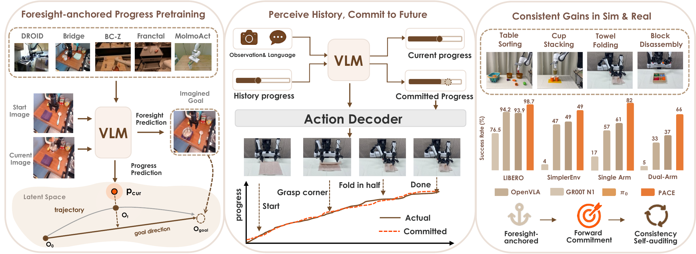
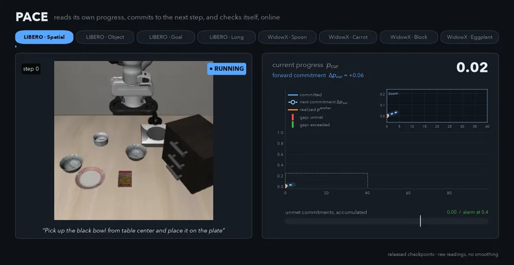
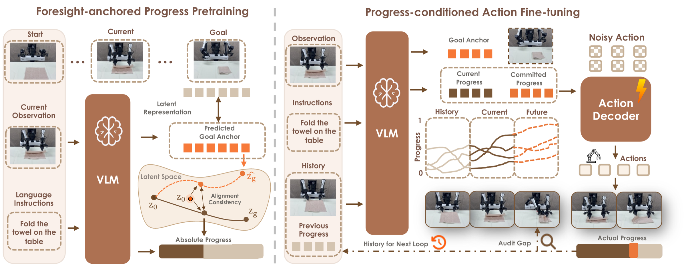
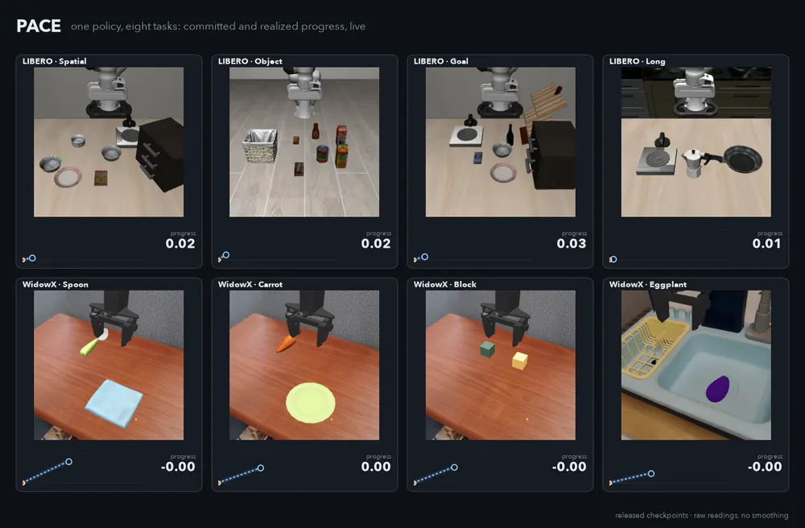
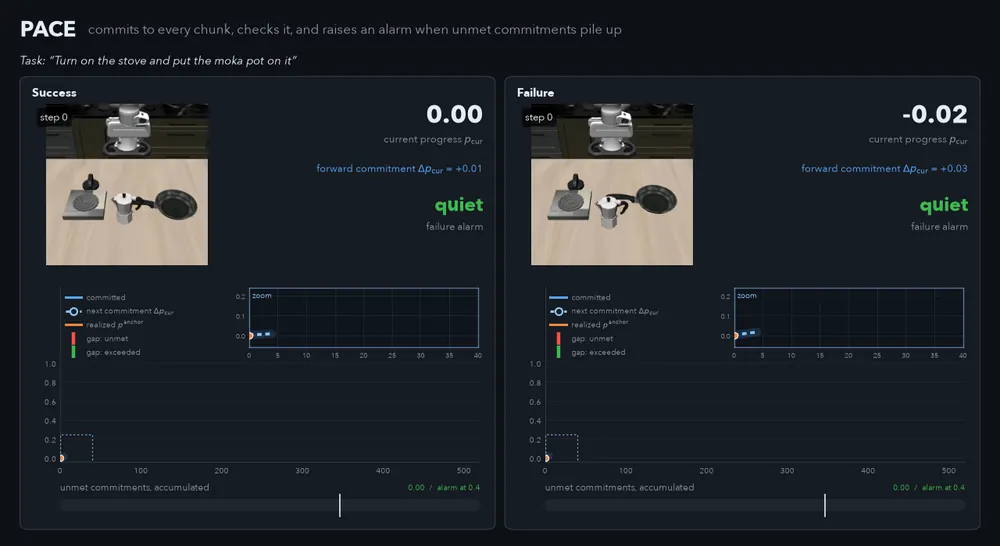

<div align="center">


# PACE

### Progress Actively-internalized Conditioning Execution for Long-horizon Manipulation

[](#citation)
[](#citation)
[](https://PACE-embodied-robotics.github.io)
[](LICENSE)
[](https://github.com/Fei-Ni/PACE)
[](https://huggingface.co/models?search=spikefly/PACE)

</div>

> ✍️ **Fei Ni**, Zhuo Chen, Xianze Yao, Zerui Chen, Changrui Chen, Yifu Yuan, Shan Luo, Jianye Hao, Jiankang Deng<br>
> 🏛️ Imperial College London · King's College London<br>
> ✉️ Primary contact: **Fei Ni** ([f.ni@imperial.ac.uk](mailto:f.ni@imperial.ac.uk))

---

<p align="center">
  
</p>

<p align="center">
  
  <br/>
  <sub>Released checkpoints, live. Before each action chunk PACE commits to how far it will advance (<b>blue</b>, dashed until the chunk has run); the <b>realized</b> progress (<b>orange</b>) follows. At every check the gap between the two drops into the meter of unmet commitments, which is the failure alarm. Raw values, no smoothing.</sub>
</p>

## 📰 News

- **[2026-10]** Code, the LIBERO checkpoint, the online failure alarm and the progress-visualization toolkit are released.

> [!NOTE]
> This repository contains the PACE model code, training and evaluation scripts for **LIBERO** and **SimplerEnv (WidowX)**, the online failure alarm, a progress-visualization toolkit, and one released checkpoint per benchmark, retrained with this codebase.

## 🔥 Highlights

- 🎯 **Foresight anchor.** From the observation and instruction alone, PACE predicts a terminal embedding ẑ<sub>g</sub> in a frozen DINOv2 space. Progress is the projection of the current frame onto the start→anchor direction, so no goal image is needed at inference.
- ⏱️ **Past–present–future progress interface.** *How much the last step advanced* (Δp<sub>prev</sub>, fed back as an input token), *how far execution has come* (p<sub>cur</sub>) and *how far the next step should go* (Δp<sub>cur</sub>, the forward commitment).
- 🧭 **Progress actively conditions actions.** ẑ<sub>g</sub>, p<sub>cur</sub> and Δp<sub>cur</sub> are prepended as conditioning tokens to the flow-matching action DiT, so progress shapes the action chunk instead of running alongside it.
- 🚨 **Knows when it is failing.** Every chunk is a commitment that the frozen encoder can check. A built-in alarm on unmet commitments and stalled progress flags **93%** of the failed LIBERO episodes at **7%** false alarms, typically with half of the episode still to go, using nothing but the policy's own outputs ([details](#-knowing-when-it-fails)).
- 📈 **Ready-to-run checkpoint.** One checkpoint for all four LIBERO suites at **98.6%**, with evaluation scripts that reproduce this number.

## 📈 Key Results

Success rate (%) of the released checkpoint, evaluated with the scripts in this repository.

<table>
<tr><th colspan="2">LIBERO (Franka)</th></tr>
<tr><td>Spatial</td><td align="right">99.0</td></tr>
<tr><td>Object</td><td align="right">99.8</td></tr>
<tr><td>Goal</td><td align="right">99.4</td></tr>
<tr><td>Long</td><td align="right">96.2</td></tr>
<tr><td><b>Average</b></td><td align="right"><b>98.6</b></td></tr>
</table>

<sub><b>Protocol.</b> One checkpoint for all four suites, 10 tasks × 50 trials per suite (500 per suite), seed 7. Each number is one evaluation of one checkpoint; the paper reports an average of 98.7.</sub>

## 💡 Method

PACE turns task progress into an internal predictive interface inside the VLA. The policy perceives its current progress from observation, commits to a forward increment, and conditions its own actions on both, all within a single forward pass:

1. **Foresight-anchored progress.** K learnable goal-query tokens are appended to the VLA input; their hidden states are mean-pooled and projected to the foresight anchor ẑ<sub>g</sub>, supervised by the frozen DINOv2 embedding of the demonstration's last frame. The progress label of a frame is its projection onto start→goal in the same space.
2. **Perceive and commit.** Two more query tokens read out p<sub>cur</sub> and Δp<sub>cur</sub>. The realized increment of the previous chunk, Δp<sub>prev</sub>, is measured with the frozen encoder against the predicted anchor and fed back as a scalar token.
3. **Condition.** ẑ<sub>g</sub>, p<sub>cur</sub> and Δp<sub>cur</sub> pass through zero-initialized MLPs and are prepended to the action DiT (Qwen3-VL-4B backbone, GR00T-style flow-matching action head).
4. **Verify.** Δp<sub>audit</sub> = realized − committed increment. An online alarm accumulates the shortfalls (commitments the policy did not meet) and watches for progress that stops rising; it reports, and never changes the actions.

<div align="center">
  
</div>

Notation, losses and the exact inference loop are in [docs/METHOD.md](docs/METHOD.md).

## 📊 Watching Progress Online

<p align="center">
  
</p>

Eight rollouts side by side: blue is the progress each chunk committed to, orange what it realized. The policy's own progress reading tracks hindsight progress closely (median Spearman ρ 0.96 on LIBERO); definitions, numbers and the rendering scripts are in [docs/PROGRESS.md](docs/PROGRESS.md).

## 🚨 Knowing When It Fails

Before every chunk PACE commits to how far it will advance; once the chunk has run, the frozen encoder measures how far it actually got. When the unmet commitments add up to 0.4 of the task, or progress stops rising, the alarm (`audit_flag`) fires. It needs no extra model and no failure labels, and it only reports: whether to stop, ask for help or retry is up to you.

<div align="center">
  
  <br/>
  <sub>Same task, success (left) and failure (right). In the failure the stove is on but the moka pot never makes it onto it: the commitments keep pointing above what is realized, the gaps pile up in the meter, and the alarm fires at step 256 with half of the time budget left.</sub>
</div>

<div align="center">

| Failed episodes caught | Successful episodes flagged | Episode left at the alarm |
|:---:|:---:|:---:|
| **93%** | 7% | **half** |

<sub>Released LIBERO checkpoint, 2,000 episodes; one threshold (0.4) for every benchmark. Calibration and a tool to set the thresholds for your own policy: [docs/PROGRESS.md](docs/PROGRESS.md#knowing-when-it-fails).</sub>

</div>

## 🤗 Model Zoo

<table>
  <tr>
    <th>Checkpoint</th>
    <th>Backbone</th>
    <th>HF Repository</th>
    <th>Note</th>
  </tr>
  <tr>
    <td><b>PACE-LIBERO</b></td>
    <td>Qwen3-VL-4B + DiT-B<br/>DINOv2 ViT-B/14 (frozen)</td>
    <td><a href="https://huggingface.co/spikefly/PACE-LIBERO">spikefly/PACE-LIBERO</a></td>
    <td>One checkpoint for all 4 LIBERO suites, average SR <b>98.6</b></td>
  </tr>
</table>

Each repository holds `pytorch_model.pt`, `config.yaml` and `dataset_statistics.json` side by side; the loader accepts the directory, the `.pt` file, or the Hub id.

## 🛠️ Installation

```bash
git clone https://github.com/Fei-Ni/PACE.git
cd PACE
conda create -n pace python=3.10 -y && conda activate pace
pip install torch==2.6.0 torchvision==0.21.0 --index-url https://download.pytorch.org/whl/cu126
pip install -r requirements.txt
pip install -e .
pip install flash-attn==2.7.4.post1 --no-build-isolation   # recommended; otherwise PACE_ATTN_IMPLEMENTATION=sdpa
```

LIBERO and SimplerEnv run in their own Python environments and talk to the policy over a WebSocket; see [docs/INFERENCE.md](docs/INFERENCE.md).

## 🎮 Getting Started

```bash
huggingface-cli download spikefly/PACE-LIBERO --local-dir ./checkpoints/PACE-LIBERO
```

```python
from pace.model.framework.base_framework import baseframework

policy = baseframework.from_pretrained("./checkpoints/PACE-LIBERO").to("cuda").eval()   # or "spikefly/PACE-LIBERO"
```

The base VLM (`Qwen/Qwen3-VL-4B-Instruct`) and the DINOv2 ViT-B/14 weights are fetched on first use; set `BASE_VLM` / `DINOV2_WEIGHTS` to use local copies.

**Evaluate on LIBERO** (two terminals):

```bash
# terminal 1 — policy server (PACE env)
bash examples/LIBERO/run_server.sh ./checkpoints/PACE-LIBERO
# terminal 2 — LIBERO client (LIBERO env); all four suites, 50 trials per task
LIBERO_PYTHON=$(which python) bash examples/LIBERO/eval_libero.sh ./checkpoints/PACE-LIBERO
```

**Evaluate on SimplerEnv-WidowX**:

```bash
bash examples/SimplerEnv/run_server.sh <checkpoint>    # terminal 1 (PACE env), e.g. a run from train_bridge.sh
SIM_PYTHON=$(which python) bash examples/SimplerEnv/eval_simpler.sh <checkpoint>   # terminal 2 (SimplerEnv env)
```

Every response also carries p<sub>cur</sub>, Δp<sub>cur</sub>, the measured Δp<sub>prev</sub> and the failure alarm (`audit_score`, `audit_stall`, `audit_flag`); the LIBERO client saves them per step next to each rollout video.

## 🏋️ Training

```bash
bash examples/LIBERO/train_libero.sh        # LIBERO, 4 suites jointly, 30K steps
bash examples/SimplerEnv/train_bridge.sh    # SimplerEnv (WidowX), BridgeData V2
```

Data preparation and the hyperparameters are in [docs/TRAINING.md](docs/TRAINING.md).

## 🙏 Acknowledgements

- **[StarVLA](https://github.com/starVLA/starVLA)**: the codebase PACE is built on (Qwen-VL + flow-matching action head framework, training and evaluation tooling).
- **[SemanticVLA](https://github.com/Fei-Ni/SemanticVLA_Offcial)**, **[UniVLA](https://github.com/OpenDriveLab/UniVLA)** and **[π<sub>0</sub> / openpi](https://github.com/Physical-Intelligence/openpi)**: prior work and open-source releases that PACE builds on.
- **[Qwen3-VL](https://github.com/QwenLM/Qwen3-VL)**: the vision-language backbone.
- **[Isaac GR00T](https://github.com/NVIDIA/Isaac-GR00T)**: the flow-matching DiT action head and LeRobot data pipeline.
- **[DINOv2](https://github.com/facebookresearch/dinov2)**: the frozen encoder behind the foresight anchor and progress labels.
- **[LIBERO](https://github.com/Lifelong-Robot-Learning/LIBERO)**, **[SimplerEnv](https://github.com/simpler-env/SimplerEnv)** and **[ManiSkill3](https://github.com/haosulab/ManiSkill)**: simulation benchmarks.
- **[BridgeData V2](https://rail-berkeley.github.io/bridgedata/)** and **[LeRobot](https://github.com/huggingface/lerobot)**: training data and data format.

More in [docs/ACKNOWLEDGEMENTS.md](docs/ACKNOWLEDGEMENTS.md); third-party licenses are listed in [THIRD_PARTY_NOTICES.md](THIRD_PARTY_NOTICES.md).

## ✏️ Citation

```bibtex
@inproceedings{ni2026pace,
  title     = {{PACE}: Progress Actively-internalized Conditioning Execution for Long-horizon Manipulation},
  author    = {Ni, Fei and Chen, Zhuo and Yao, Xianze and Chen, Zerui and Chen, Changrui and Yuan, Yifu and Luo, Shan and Hao, Jianye and Deng, Jiankang},
  booktitle = {Advances in Neural Information Processing Systems (NeurIPS)},
  year      = {2026}
}
```

## 📜 License

Released under the [MIT License](LICENSE). Third-party components keep their own licenses; see [THIRD_PARTY_NOTICES.md](THIRD_PARTY_NOTICES.md).
