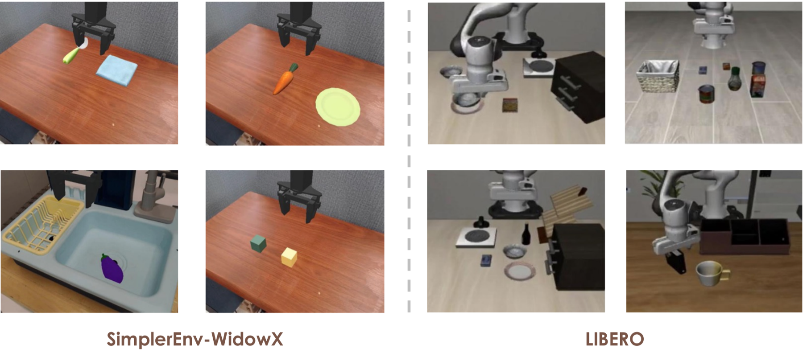

# Inference and Evaluation

Evaluation uses a **policy server** (the PACE model, in the PACE environment) and a **benchmark client** (LIBERO or SimplerEnv, in the benchmark's own environment) that talk over a WebSocket. Start the server first, then the client.

<div align="center">
  
  <br/><sub>Evaluation scenes: LIBERO (Franka) and SimplerEnv (WidowX).</sub>
</div>

## 1. Install

**Policy environment** (runs the model):

```bash
conda create -n pace python=3.10 -y && conda activate pace
pip install torch==2.6.0 torchvision==0.21.0 --index-url https://download.pytorch.org/whl/cu126
pip install -r requirements.txt
pip install -e .
pip install flash-attn==2.7.4.post1 --no-build-isolation
```

The released numbers were produced with flash-attn. Without it, set `PACE_ATTN_IMPLEMENTATION=sdpa`; the model runs, but outputs are not bit-identical to ours.

**Benchmark environments** (run the simulators). Install [LIBERO](https://github.com/Lifelong-Robot-Learning/LIBERO) or [SimplerEnv](https://github.com/simpler-env/SimplerEnv) with ManiSkill3 as described by their authors, then add the client packages listed at the bottom of [requirements.txt](../requirements.txt) (`tyro`, `imageio[ffmpeg]`, `transforms3d`, `websockets`, `msgpack`, `omegaconf`, `pyyaml`, `huggingface_hub`, `opencv-python-headless`). The clients import this repository from `PYTHONPATH` (the launchers set it); they do not need torch or the model stack.

## 2. Download the checkpoints

```bash
huggingface-cli download spikefly/PACE-LIBERO --local-dir ./checkpoints/PACE-LIBERO
```

`./checkpoints/PACE-LIBERO` is the default path of the LIBERO launchers. Anywhere a checkpoint is expected you can pass the directory, its `pytorch_model.pt`, a training-run checkpoint (`<run>/checkpoints/steps_N_pytorch_model.pt`), or the Hub id itself (`spikefly/PACE-LIBERO`).

On first use the loader also needs:

| What | Default | Override |
|---|---|---|
| Qwen3-VL-4B-Instruct (tokenizer, processor, architecture) | downloaded from the Hub | `BASE_VLM=/path/or/hub-id` |
| DINOv2 ViT-B/14 weights (`dinov2_vitb14_pretrain.pth`, 346 MB) | downloaded to `$PACE_CACHE/dinov2` (`~/.cache/pace`) | `DINOV2_WEIGHTS=/path/to/file.pth` |
| DINOv2 code | vendored `third_party/dinov2` | `DINO_REPO_ROOT` |

## 3. Use the policy in Python

```python
from PIL import Image
from pace.model.framework.base_framework import baseframework

policy = baseframework.from_pretrained("./checkpoints/PACE-LIBERO").to("cuda").eval()

images = [Image.open("agentview.png"), Image.open("wrist.png")]           # one list of views per sample
out = policy.predict_action(batch_images=[images],
                            instructions=["put the bowl on the plate"],
                            step=0, do_sample=False)                         # step = environment step
out["normalized_actions"]      # [1, 8, 7] action chunk in normalized units
out["predicted_progress"]      # p_cur
out["predicted_delta_progress"]  # Δp_cur (forward commitment)
out["observed_dp_prev"]          # Δp_prev, the realized increment measured by the frozen encoder
out["audit_flag"]                # failure alarm (also audit_score, audit_stall); monitoring only
```

Send the environment step with every call: the policy keeps one online state per instruction (start frame, history frame, foresight anchor, failure-alarm state), resets it at `step=0`, and uses as history the latest query at or before step t − Δ (with the LIBERO client, which queries every 8 steps, that is t − 8).

Pre-process images the way the benchmark clients do: the LIBERO client rotates both camera images by 180° (LIBERO renders them upside down) and resizes them to 224 × 224; the SimplerEnv checkpoint resizes to 224 × 224 itself (`image_size` in its config). The released numbers were produced with the model cast to bfloat16 (`policy.to(torch.bfloat16)`), which is what `run_server.sh` does. `normalized_actions` are unnormalized with the checkpoint's `dataset_statistics.json`; the benchmark clients do this for you. See [METHOD.md](METHOD.md#outputs-of-predict_action) for all outputs.

## 4. LIBERO

```bash
# terminal 1 (PACE env)
bash examples/LIBERO/run_server.sh ./checkpoints/PACE-LIBERO 10093

# terminal 2 (LIBERO env)
LIBERO_PYTHON=$(which python) bash examples/LIBERO/eval_libero.sh ./checkpoints/PACE-LIBERO
```

Default protocol: the four suites one after another, 10 tasks × 50 trials each, seed 7, 10 idle steps at the start of every episode. Results go to `results/libero_eval/<timestamp>/<suite>/` (`eval.log`, and under `videos/` the suite's `summary.json` plus one video and one progress trace per episode) and a final table of per-suite and average success. To split suites across GPUs, start one server per GPU on different ports and pass `SUITES=libero_goal POLICY_PORT=10094 OUT_DIR=<same dir>`; then run `examples/LIBERO/aggregate_libero.py --eval_dir <dir>`.

Expected (released checkpoint): Spatial 99.0, Object 99.8, Goal 99.4, Long 96.2, average **98.6**.

| Variable | Default | Meaning |
|---|---|---|
| `LIBERO_PYTHON` | `python` | interpreter of the LIBERO environment |
| `LIBERO_HOME` | – | LIBERO checkout to add to `PYTHONPATH` (not needed if pip-installed) |
| `POLICY_HOST`, `POLICY_PORT` | `127.0.0.1`, `10093` | policy server address |
| `SUITES` | all four | space-separated suite names |
| `NUM_TRIALS`, `SEED` | `50`, `7` | trials per task, environment seed |
| `OUT_DIR` | `results/libero_eval/<timestamp>` | output directory |

## 5. SimplerEnv (WidowX, ManiSkill3)

```bash
# terminal 1 (PACE env)
bash examples/SimplerEnv/run_server.sh <checkpoint> 10093

# terminal 2 (SimplerEnv-ManiSkill3 env)
SIM_PYTHON=$(which python) bash examples/SimplerEnv/eval_simpler.sh <checkpoint>
```

Default protocol: Put Spoon on Towel, Put Carrot on Plate, Stack Green Block on Yellow Block, Put Eggplant in Basket, 24 episodes each (seeds 0–23), the policy queried every step and its chunks combined by adaptive action ensembling (`ACTION_ENSEMBLE=1`). Results go to `results/simpler_eval/<timestamp>/`.

| Variable | Default | Meaning |
|---|---|---|
| `SIM_PYTHON` | `python` | interpreter of the SimplerEnv-ManiSkill3 environment |
| `SIMPLERENV_PATH` | – | SimplerEnv checkout to add to `PYTHONPATH` |
| `MS_ASSET_DIR` | ManiSkill default | ManiSkill asset directory |
| `POLICY_HOST`, `POLICY_PORT` | `127.0.0.1`, `10093` | policy server address |
| `EPISODES`, `SEED` | `24`, `0` | episodes per task, first seed |
| `ACTION_ENSEMBLE` | `1` | adaptive action ensembling on/off |
| `TASKS` | the four tasks | space-separated task names |
| `SIMPLER_RECORD_DIR` | off | save frames and per-step progress for [tools/progress_viz](../tools/progress_viz) |
| `OUT_DIR` | `results/simpler_eval/<timestamp>` | output directory |

## 6. Server options

`run_server.sh [CKPT] [POLICY_PORT]` wraps `python -m deployment.model_server.server_policy`. `BIND_HOST` (bind address, default `0.0.0.0`), `USE_BF16` (default `1`: the model runs in bfloat16, as in our evaluations) and `PYTHON` can be set in the environment. The server answers any client that sends the same message format (`batch_images`, `instructions`, `step`); see `examples/*/model2*_interface.py` for reference clients.

Both launchers accept `--dry-run`, which prints the effective settings and exits.

The failure-alarm thresholds are read from the checkpoint's `config.yaml` (`framework.progress.audit_threshold`, `audit_stall_chunks`, `audit_kappa`); edit them there, for example with the output of `tools/progress_viz/calibrate_audit.py` ([PROGRESS.md](PROGRESS.md#calibrating-your-own-policy)). They only affect the reported alarm, never the actions.
